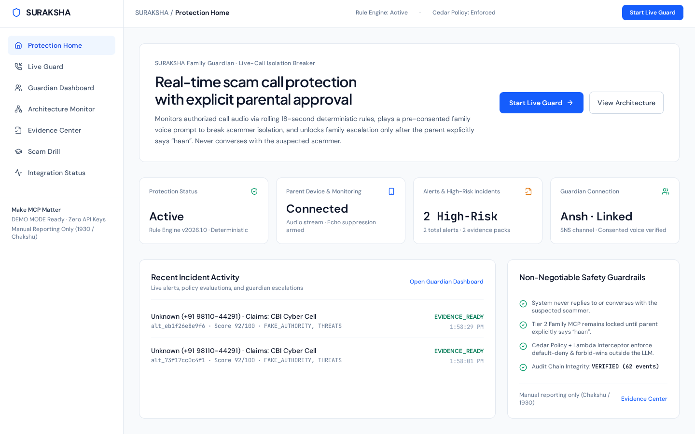
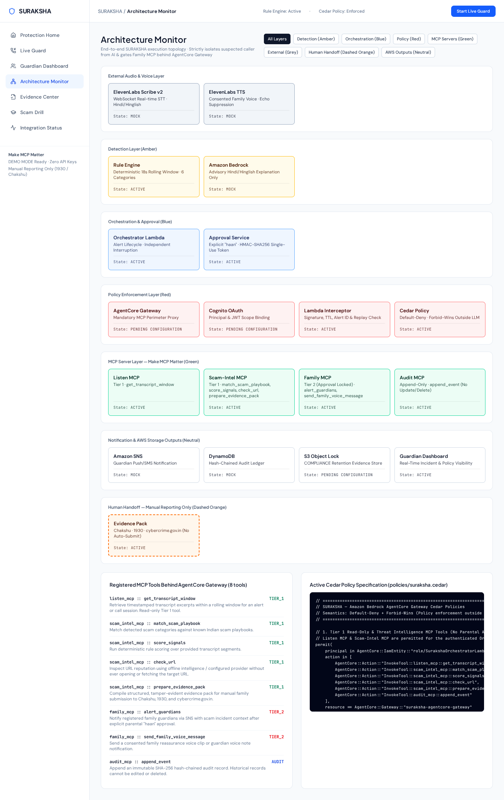
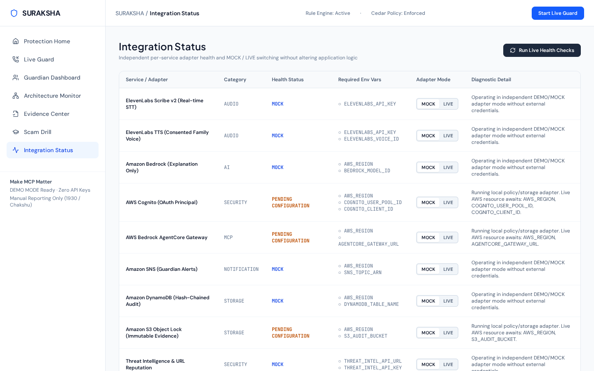
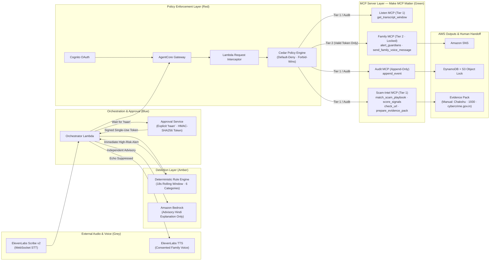

<div align="center">

# SURAKSHA — Family Scam-Call Protection System

**Real-time scam-call detection, consented family voice interruption, explicit cryptographic approval, and policy-enforced MCP orchestration.**

Built for **wHACKiest 2026** · Track: **Make MCP Matter**

[](https://surakshademo.netlify.app/)
[](.github/workflows/ci.yml)
[](tests/)
[](#-quick-start-demo-mode--zero-api-keys-required)
[](#-mcp-server-breakdown-srcmcp)
[](policies/suraksha.cedar)
[](LICENSE)

[**Live Demo**](https://surakshademo.netlify.app/) · [Overview](#-overview) · [Why MCP Matters](#-why-make-mcp-matter) · [Screenshots](#-screenshots) · [Architecture](#-system-architecture) · [Quick Start](#-quick-start-demo-mode--zero-api-keys-required) · [Live Mode Setup](#-switching-to-live-mode-when-hackathon-api-keys-are-provided) · [Hackathon Day & Roadmap](#-main-offline-hackathon-day--scope-of-improvement)

</div>

---

## 🎯 Overview

Fraudsters isolate victims—especially elderly parents—during live phone and video calls by impersonating **CBI, Mumbai Police, Customs, TRAI, or Bank KYC** desks with fabricated *"Digital Arrest"* warrants and threats of imminent prosecution while demanding total secrecy (*"ghar walon ko mat batana"*).

**SURAKSHA** breaks scammer isolation in real time **without ever conversing with the suspected caller or letting an LLM authorize family actions**:

| Step | Layer | What SURAKSHA Does |
| --- | --- | --- |
| **1. Stream** | ElevenLabs Scribe v2 Adapter | Streams timestamped call transcripts (`Hindi`, `Hinglish`, `English`). |
| **2. Detect** | Deterministic Rule Engine | Scores **18-second rolling windows** across 6 scam tactic categories in **`<1 ms`** with zero LLM dependency. |
| **3. Interrupt Parent** | Consented Family Voice TTS | Plays pre-consented family prompt **`"Kya main Ansh ko abhi bula loon?"`** only on the parent's device with **Echo Suppression** active. |
| **4. Advise Family** | Amazon Bedrock (Advisory) | Independently generates calm Hindi/Hinglish family guidance—never blocks detection and never touches authorization. |
| **5. Explicit Consent** | Approval Service | Rejects ambiguous speech (`"theek hai"`, `"nahi"`). Only explicit **`"haan"`** mints a single-use, alert-bound **HMAC-SHA256 token**. |
| **6. Enforce Policy** | AgentCore Gateway + Cedar | Validates signature, TTL, `alert_id`, scope, and one-time nonce before permitting Tier 2 **`family_mcp`**. |
| **7. Preserve Evidence** | Audit MCP + Evidence Pack | Appends every allow/deny event to a **SHA-256 hash-chained ledger** and exports JSON/HTML Evidence Packs for **manual submission** to **Chakshu**, **1930**, and **cybercrime.gov.in**. |

> **Live Demo & Zero-Key Evaluation:**  
> **Live Deployment:** [**https://surakshademo.netlify.app/**](https://surakshademo.netlify.app/) (configured via [`netlify.toml`](netlify.toml) and [`netlify/functions/api.ts`](netlify/functions/api.ts)).  
> No AWS or ElevenLabs API keys are needed to run, test, or evaluate SURAKSHA. Every security control—deterministic scoring, HMAC-SHA256 token issuance/replay protection, 4 `@modelcontextprotocol/sdk` servers, Cedar `forbid`-wins policy evaluation, and SHA-256 hash chaining—executes genuinely in **DEMO MODE**. When hackathon credentials are supplied, individual adapters switch independently from `MOCK` to `LIVE` via `.env`.

---

## 🔐 Why "Make MCP Matter"

Most agent demos treat MCP as an unauthenticated RPC wrapper directly driven by an LLM. **SURAKSHA makes MCP a real security boundary:**

- **Tier Separation:** Read/intel tools (`listen_mcp`, `scam_intel_mcp`) and append-only logging (`audit_mcp`) are Tier 1/Audit; high-impact family escalation (`family_mcp`) is **Tier 2** and physically unreachable without a verified human consent token.
- **LLM Excluded from Authorization:** Bedrock provides Hindi explanations only. Any `LLM`-originated call to Tier 2 tools—even if spoofed with override flags—hits Cedar `forbid` rules (`cedar-forbid-llm-tier2`).
- **Scammer Isolation Enforced at Policy Layer:** Attempting `reply_to_scammer` is explicitly forbidden in [`policies/suraksha.cedar`](policies/suraksha.cedar) (`cedar-forbid-scammer-reply`).
- **Prove Both Allowed & Blocked Paths Live:** In the UI, evaluators can click **Block Missing Token**, **Block LLM Override**, **Block Token Replay**, or **Block Scammer Reply** to watch AgentCore Gateway + Lambda Interceptor + Cedar reject unauthorized calls and append `AUTHZ_DENY` records in real time.

---

## 📸 Screenshots

### 1. Protection Home
Overview of parent monitoring status, high-risk incident counters, linked guardian (`Ansh`), recent activity, and verified SHA-256 hash-chain integrity.



### 2. Live Guard — Real-Time Detection, Interruption, Policy Block & `"Haan"` Approval
Shows progressive Hinglish transcript streaming, deterministic Rule Engine scoring (`100/100`), the pre-consented `"Kya main Ansh ko abhi bula loon?"` interruption with Echo Suppression, advisory Bedrock Hindi guidance, ambiguous-speech rejection + `"haan"` approval minting a single-use token, and a blocked replay attempt (`GATEWAY RESULT: DENIED`).


### 3. Guardian Dashboard
Incident drill-down for family guardians displaying matched indicators, Amazon SNS delivery payload, blocked policy attempts, and the alert's SHA-256 hash-chained audit records.


### 4. Architecture Monitor & Live MCP Registry
Color-coded SURAKSHA execution topology paired with the live `@modelcontextprotocol/sdk` tool registry behind AgentCore Gateway and the active `policies/suraksha.cedar` specification.



### 5. Evidence Center & Hash-Chain Verification
Verifies the complete SHA-256 hash chain, exports downloadable JSON and printable HTML/PDF-ready Evidence Packs, and enforces `EVIDENCE READY – MANUAL FAMILY SUBMISSION REQUIRED` for Chakshu, 1930, and `cybercrime.gov.in`.


### 6. Scam Drill & Secondary Message/URL Checker (Strictly Isolated)
Interactive family training drills paired with an offline SMS/WhatsApp + URL reputation analyzer that **never connects to Live Guard** and **never opens or fetches submitted links**.


### 7. Integration Status (Independent `MOCK` / `LIVE` Adapters)
Evaluates real-time readiness per adapter (`MOCK`, `PENDING CONFIGURATION`, `LIVE`, `CONNECTION FAILED`) and allows toggling each integration independently once hackathon keys are configured.



---

## 🏗 System Architecture



---

## 🧩 MCP Server Breakdown (`src/mcp/`)

All four MCP servers are implemented using `@modelcontextprotocol/sdk` (`McpServer` + Zod input schemas + `InMemoryTransport`) behind `AgentCoreGatewayRouter`:

| MCP Server | Tier | Registered Tools | Authorization Policy |
| --- | --- | --- | --- |
| **Listen MCP** | Tier 1 | `get_transcript_window` | Orchestrator Gateway permit (no parental token required) |
| **Scam-Intel MCP** | Tier 1 | `match_scam_playbook`, `score_signals`, `check_url`, `prepare_evidence_pack` | Orchestrator Gateway permit (URL check is offline-only, never fetches URLs) |
| **Family MCP** | Tier 2 | `alert_guardians`, `send_family_voice_message` | **MANDATORY** valid, unexpired, unused, alert-bound `"haan"` HMAC-SHA256 token + Cedar `PERMIT` |
| **Audit MCP** | Audit | `append_event` | Append-only; `update_event` and `delete_event` explicitly forbidden in Cedar |

### Key REST API Endpoints (`server.ts`)

| Endpoint | Purpose |
| --- | --- |
| `GET /api/dashboard` | Protection Home KPIs, recent incidents, and audit chain integrity |
| `POST /api/sessions` · `POST /api/sessions/:id/transcript` | Start call monitor & stream progressive transcript segments |
| `POST /api/alerts/:id/approval` | Submit parent utterance (`"haan"` vs ambiguous/decline) |
| `POST /api/gateway/test-unauthorized` | Trigger real policy-enforcement denial checks via Gateway + Cedar |
| `GET /api/evidence/:id/download?format=json\|html` | Download tamper-evident JSON or printable HTML Evidence Pack |
| `GET /api/audit` · `GET /api/audit/verify` | Inspect and verify the full SHA-256 hash-chained audit ledger |
| `POST /api/drill/check-message` | Isolated offline SMS/WhatsApp & URL inspection |
| `GET /api/integrations` · `POST /api/integrations/:id/mode` | Inspect adapter health and switch `MOCK` / `LIVE` modes independently |

---

## 🚀 Quick Start (DEMO MODE — Zero API Keys Required)

### Prerequisites
- **Node.js** `>= 20` (tested on Node 22)
- **npm** `>= 10`

### 1. Try the Hosted Demo or Launch Locally

- **Hosted Live Demo:** [**https://surakshademo.netlify.app/**](https://surakshademo.netlify.app/)

```bash
git clone <your-repo-url>
cd suraksha-mcp-guardian
npm install
npm run dev
```
Open **`http://localhost:3000`**.

### 2. Run Automated Tests, Type-Check & Production Build
```bash
npm test                     # Runs 17 deterministic unit, security, MCP, serverless & E2E tests
npm run lint                 # Strict TypeScript check (tsc --noEmit)
npm run build                # Vite production frontend bundle
NODE_ENV=production npm start # Serve production build via Express on port 3000
```

All **17/17 automated tests** verify:
- **Detection**: Normal baseline, single-keyword non-triggering, fake bank OTP, CBI/Police impersonation, Digital Arrest + isolation, AnyDesk remote access, Devanagari Hindi, 18s rolling-window expiration, and deduplication.
- **Approval Security**: Explicit `"haan"` matching, ambiguous rejection, duplicate-approval idempotency, missing/invalid/tampered signatures, expired tokens, alert ID mismatches, unauthorized tool scopes, and single-use replay prevention.
- **Cedar Policy & MCP**: Tier 1 allowed without token, Tier 2 blocked without token, LLM override explicitly forbidden, scammer reply blocked, and Tier 2 succeeds once with valid token.
- **Audit Chain, Serverless & E2E**: SHA-256 previous/event hash verification, historical tamper detection, `PB_DIGITAL_ARREST` playbook matching, Express & Netlify Functions API routing, and full end-to-end Evidence Pack generation.

---

## 🔌 Switching to LIVE MODE (When Hackathon API Keys Are Provided)

SURAKSHA isolates every external service behind clean TypeScript adapter interfaces (`SpeechToTextProvider`, `TextToSpeechProvider`, `LLMProvider`, `NotificationProvider`, `GatewayProvider`, `AuditStorageProvider`, `ThreatIntelligenceProvider`).

1. Copy `.env.example` to `.env`:
   ```bash
   cp .env.example .env
   ```
2. Add credentials only for the services you want to activate (missing Bedrock keys never block Scribe/TTS or the Rule Engine):

| Integration | Required Env Vars | Live Adapter |
| --- | --- | --- |
| **ElevenLabs Scribe v2** | `ELEVENLABS_API_KEY` | `ElevenLabsScribeProvider` (`wss://api.elevenlabs.io/v1/speech-to-text/realtime`) |
| **ElevenLabs TTS** | `ELEVENLABS_API_KEY`, `ELEVENLABS_VOICE_ID` | `ElevenLabsTTSProvider` |
| **Amazon Bedrock** | `AWS_REGION`, `BEDROCK_MODEL_ID` (+ IAM role or AWS keys) | `AmazonBedrockProvider` (`ConverseCommand`) |
| **Cognito & AgentCore Gateway** | `AWS_REGION`, `COGNITO_USER_POOL_ID`, `COGNITO_CLIENT_ID`, `AGENTCORE_GATEWAY_URL` | `AwsAgentCoreGatewayProvider` |
| **Amazon SNS** | `AWS_REGION`, `SNS_TOPIC_ARN` | `AmazonSNSProvider` |
| **DynamoDB & S3 Object Lock** | `AWS_REGION`, `DYNAMODB_TABLE_NAME`, `S3_AUDIT_BUCKET` | `AwsDynamoS3AuditProvider` (`COMPLIANCE` retention) |

3. Optional per-service overrides (`MOCK` or `LIVE`) can be set via `SURAKSHA_*_MODE` env vars or toggled directly in **Integration Status**, followed by **Run Live Health Checks**.

See [`infra/aws-deployment-architecture.md`](infra/aws-deployment-architecture.md) for AWS Lambda handlers (`src/lambda/`), IAM least-privilege policies, and Cognito/AgentCore Gateway setup notes.

---

## 🛠 Main Offline Hackathon Day & Scope of Improvement

### What We Will Execute on Main Offline Hackathon Day
When hackathon mentor/sponsor credentials and live demo hardware are available on-site, SURAKSHA switches seamlessly from `MOCK` to `LIVE` without changing core detection or policy code:

- **Two-Phone Live Audio Demo:** Run ElevenLabs Scribe v2 real-time WebSocket transcription (`ELEVENLABS_API_KEY`) and ElevenLabs Consented Family Voice TTS (`ELEVENLABS_VOICE_ID`) across two physical devices (simulated scammer caller vs. parent speaker with echo suppression).
- **Live AWS Escalation & Policy Enforcement:** Enable `AmazonBedrockProvider` (Hindi/Hinglish family guidance), `AwsAgentCoreGatewayProvider` + Cognito OAuth (`policies/suraksha.cedar`), and `AmazonSNSProvider` so saying `"haan"` dispatches a real SMS/push alert to the guardian's physical phone live on stage.
- **Immutable Cloud Audit Storage:** Activate `AwsDynamoS3AuditProvider` and deploy `src/lambda/orchestratorHandler.ts` + `src/lambda/gatewayInterceptor.ts` behind AWS API Gateway so hash-chained events and Evidence Packs persist to DynamoDB and S3 Object Lock (`COMPLIANCE` mode).

### Scope of Improvement (Future Roadmap)
- **Carrier / VoIP Media Streams:** Integrate SIP/WebRTC audio streams (e.g., Exotel / Twilio Media Streams) with device-level Acoustic Echo Cancellation (AEC) for zero-friction protection on native cellular and WhatsApp calls.
- **Pan-India Multilingual Coverage:** Expand `DeterministicRuleEngine` rules, consented family prompts, and affirmative consent matchers beyond Hindi, Hinglish, and English to Tamil, Telugu, Marathi, Bengali, Gujarati, and Kannada.
- **Speaker Voiceprint Binding for `"haan"`:** Pair HMAC-SHA256 approval tokens with local parent speaker verification so a caller cannot spoof the parent's explicit approval over the call.
- **Distributed Session & Token Store:** Back active call sessions and single-use nonce tracking with DynamoDB TTL tables for horizontal multi-instance serverless scaling, alongside a lightweight Android/iOS companion app.
- **Live Cyber-Threat Feed Integration:** Connect `ConfigurableThreatIntelligenceProvider` to verified I4C / phishing domain feeds while preserving the strict non-fetching offline inspection invariant.

---

## 📂 Project Structure

```text
├── .github/
│   ├── workflows/ci.yml               # Automated lint, test & Vite build workflow
│   └── PULL_REQUEST_TEMPLATE.md       # Safety-first PR checklist
├── .env.example                       # Placeholder env configuration (zero secrets)
├── policies/
│   └── suraksha.cedar                 # Default-deny + forbid-wins Cedar policy file
├── infra/
│   └── aws-deployment-architecture.md # AWS Lambda, AgentCore, SNS, DynamoDB & S3 guide
├── docs/screenshots/                  # Verified UI screenshots for documentation
├── src/
│   ├── core/                          # Pure deterministic & cryptographic modules
│   │   ├── ruleEngine.ts              # 18s rolling-window multi-signal scam detector
│   │   ├── approvalService.ts         # HMAC-SHA256 single-use "haan" token service
│   │   ├── cedarPolicy.ts             # Cedar policy evaluator (outside LLM)
│   │   ├── auditChain.ts              # SHA-256 hash-chained append-only audit log
│   │   ├── scamIntelligence.ts        # Indian scam playbooks & offline URL checker
│   │   ├── evidencePack.ts            # JSON & printable HTML Evidence Pack builder
│   │   └── scenarios.ts               # Hindi/Hinglish/English call scenarios
│   ├── mcp/                           # 4 official @modelcontextprotocol/sdk servers
│   │   ├── listenMcp.ts               # Tier 1: get_transcript_window
│   │   ├── scamIntelMcp.ts            # Tier 1: playbook, scoring, URL, evidence
│   │   ├── familyMcp.ts               # Tier 2: alert_guardians, send_family_voice_message
│   │   ├── auditMcp.ts                # Append-only: append_event
│   │   └── gatewayRouter.ts           # AgentCore Gateway + Interceptor + Cedar router
│   ├── providers/                     # Independent MOCK & LIVE service adapters
│   ├── lambda/                        # Deployable AWS Lambda Orchestrator & Interceptor
│   ├── services/                      # Orchestrator & isolated Scam Drill service
│   └── components/                    # 7-page React Guardian Dashboard UI
├── netlify/
│   └── functions/api.ts               # Serverless Express wrapper for Netlify /api/* routes
├── netlify.toml                       # Netlify build, Cedar bundle & /api/* redirect config
├── tests/                             # 17 automated unit, security, serverless & E2E tests
├── CONTRIBUTING.md                    # Architecture invariants & extension guide
├── LICENSE                            # Apache-2.0 License
├── src/serverApp.ts                   # Decoupled Express API + MCP gateway factory
└── server.ts                          # Full-stack Express + Vite entrypoint (port 3000)
```
