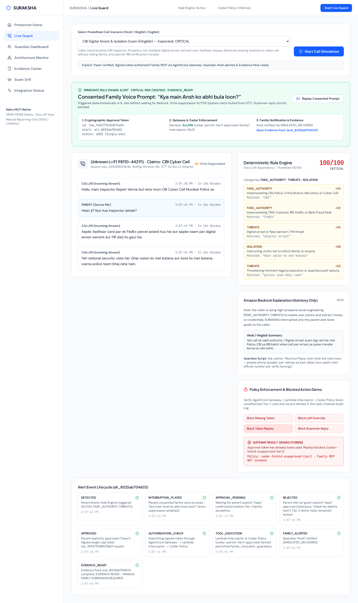
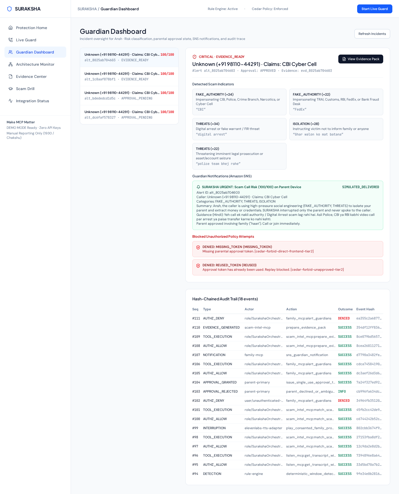
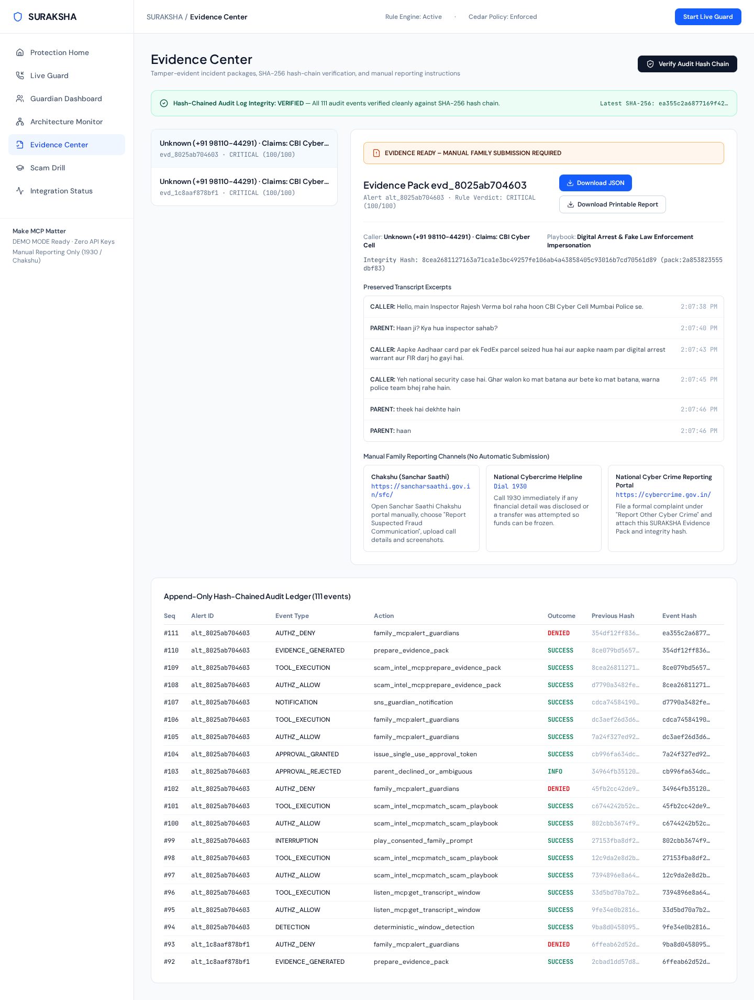
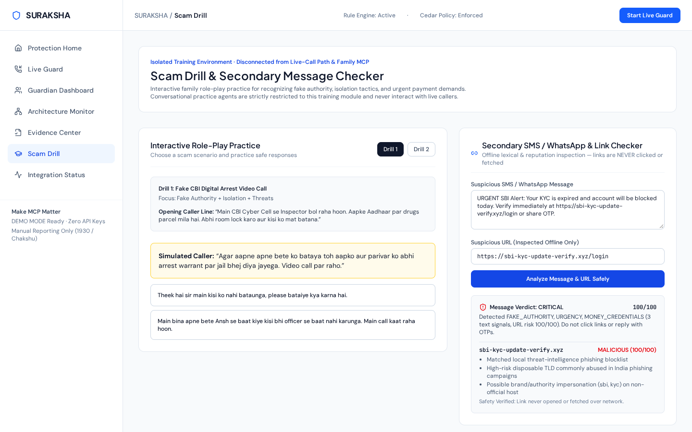
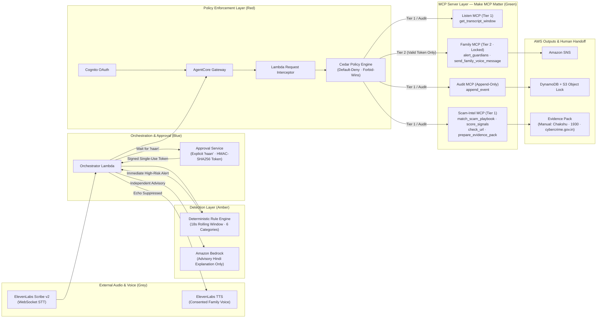

# SURAKSHA — Family Scam-Call Protection System

> **Live-call scam detection, consented family voice interruption, cryptographic explicit approval, and policy-enforced MCP orchestration.**  
> Built for **wHACKiest 2026** · Track: **Make MCP Matter**

---

## Overview

Scammers isolate victims—especially elderly parents—during live phone and video calls by impersonating CBI, Police, Customs, TRAI, or Bank officials with threats of *"Digital Arrest"*, fake FIRs, or imminent account freezes while demanding secrecy (*"kisi ko mat batana"*).

**SURAKSHA** breaks that isolation without ever exposing the suspected caller to an AI voice agent:

1. **Monitors** authorized live call audio and streams timestamped transcripts (`Hindi`, `Hinglish`, `English`).
2. **Detects** scam tactics deterministically across rolling **18-second** windows—triggering high-risk alerts in `<1 ms` without waiting on an LLM.
3. **Interrupts only the parent** with a calm, pre-consented family voice clip (`"Kya main Ansh ko abhi bula loon?"`), with echo suppression active so the prompt never re-triggers detection.
4. **Explains** the risk independently in Hindi/Hinglish for the family via Amazon Bedrock (advisory only—never in the authorization path).
5. **Enforces Explicit Human Consent**: Tier 2 family escalation stays locked until the parent explicitly says **"haan"**, minting a single-use, alert-bound **HMAC-SHA256 approval token**.
6. **Routes Every Tool Call Through Policy-Enforced MCP**: All 4 MCP servers run behind **AgentCore Gateway + Lambda Request Interceptor + Cedar Policy** (`Default-Deny` + `Forbid-Wins`).
7. **Preserves Tamper-Evident Evidence**: Appends every event to a **SHA-256 hash-chained audit ledger** and compiles a downloadable JSON & printable HTML Evidence Pack for **manual family submission** to **Chakshu**, **1930**, and **cybercrime.gov.in**.

> **Zero-Key Readiness for Judges & Reviewers:**  
> No AWS or ElevenLabs API keys are required to run or evaluate the full system today. SURAKSHA runs end-to-end in **DEMO MODE** with real deterministic detection, real HMAC-SHA256 token validation, real `@modelcontextprotocol/sdk` MCP servers, real Cedar policy enforcement, and real SHA-256 hash chaining. When hackathon credentials are provided, individual adapters switch independently from `MOCK` to `LIVE` via `.env` with zero business-logic changes.

---

## Screenshots

### 1. Protection Home
Overview of parent device status, high-risk incident counters, linked guardian (`Ansh`), recent activity, and verified audit chain integrity.


### 2. Live Guard — Real-Time Detection, Interruption, Policy Block & `"Haan"` Approval
Demonstrates progressive Hinglish transcript streaming, deterministic Rule Engine scoring (`100/100`), the pre-consented `"Kya main Ansh ko abhi bula loon?"` prompt with Echo Suppression, advisory Bedrock Hindi guidance, a blocked unauthorized Tier 2 call (`GATEWAY RESULT: DENIED`), and explicit `"haan"` approval minting a single-use token to alert the guardian.



### 3. Guardian Dashboard
Incident drill-down for family guardians showing matched scam indicators, Amazon SNS delivery payload, blocked unauthorized attempts, and the alert's SHA-256 hash-chained audit records.



### 4. Architecture Monitor & Live MCP Registry
Color-coded system topology matching the SURAKSHA architecture alongside live registered MCP tools behind AgentCore Gateway and the active `policies/suraksha.cedar` specification.


### 5. Evidence Center & Hash-Chain Verification
Verifies the full SHA-256 hash chain, provides one-click JSON and printable HTML/PDF-ready Evidence Pack downloads, and displays `EVIDENCE READY – MANUAL FAMILY SUBMISSION REQUIRED` with Chakshu, 1930, and `cybercrime.gov.in` reporting steps.



### 6. Scam Drill & Secondary Message/URL Checker (Strictly Isolated)
Interactive family training drills and an offline SMS/WhatsApp + URL reputation analyzer that **never connects to Live Guard** and **never opens or fetches submitted links**.



### 7. Integration Status (Independent `MOCK` / `LIVE` Adapters)
Calculates live configuration and health status per integration (`MOCK`, `PENDING CONFIGURATION`, `LIVE`, `CONNECTION FAILED`) and lets hackathon operators flip adapters independently once keys arrive.


---

## System Architecture



### Non-Negotiable Safety Guardrails

- **Never talks to the scammer:** No AI agent or automated voice ever replies to the incoming caller.
- **LLM is outside authorization:** Amazon Bedrock only generates family explanations and Hindi guidance; Cedar `forbid` rules explicitly block any LLM-originated Tier 2 invocation.
- **Explicit `"haan"` only:** Ambiguous utterances (`"theek hai"`, `"hello"`, `"nahi"`) are rejected; only explicit affirmative `"haan"` mints an alert-bound, short-TTL, single-use token.
- **Append-only audit trail:** `Audit MCP` exposes only `append_event` (zero edit/delete tools) with SHA-256 hash chaining (`previous_event_hash` → `event_hash`).
- **Manual cybercrime reporting only:** Evidence Packs guide the family to submit manually via **Chakshu**, **1930**, and **cybercrime.gov.in**—no automated police/Chakshu submission.

---

## MCP Server Breakdown (`src/mcp/`)

All four MCP servers are implemented using the official `@modelcontextprotocol/sdk` (`McpServer` + Zod input schemas + `InMemoryTransport`) behind `AgentCoreGatewayRouter`:

| MCP Server | Tier | Tools | Authorization Requirement |
| --- | --- | --- | --- |
| **Listen MCP** | Tier 1 | `get_transcript_window` | Orchestrator IAM / Gateway permit (no parental token required) |
| **Scam-Intel MCP** | Tier 1 | `match_scam_playbook`, `score_signals`, `check_url`, `prepare_evidence_pack` | Orchestrator IAM / Gateway permit (offline URL check never fetches links) |
| **Family MCP** | Tier 2 | `alert_guardians`, `send_family_voice_message` | **MANDATORY** valid, unexpired, unused, alert-bound `"haan"` HMAC-SHA256 token + Cedar `PERMIT` |
| **Audit MCP** | Audit | `append_event` | Append-only; `update_event` and `delete_event` explicitly forbidden in Cedar |

---

## Quick Start (DEMO MODE — Zero API Keys Required)

### Prerequisites
- Node.js `>= 20`
- npm `>= 10`

### 1. Install & Run Locally
```bash
npm install
npm run dev
```
Open **`http://localhost:3000`**.

### 2. Run Automated Tests, Type-Check & Production Build
```bash
npm test          # Runs 15 deterministic unit, security, MCP, audit & E2E tests
npm run lint      # TypeScript strict check (tsc --noEmit)
npm run build     # Vite production bundle
```

All **15/15 automated tests** verify:
- **Detection**: Normal baseline, single-keyword non-triggering, fake bank OTP, CBI/Police impersonation, Digital Arrest + isolation, AnyDesk remote access, Devanagari Hindi, 18s rolling window expiration, and deduplication.
- **Approval Security**: Explicit `"haan"` matching, ambiguous rejection, missing/invalid/tampered signatures, expired tokens, alert ID mismatches, unauthorized tool scopes, and single-use replay prevention.
- **Cedar Policy & MCP**: Tier 1 allowed without token, Tier 2 blocked without token, LLM override explicitly forbidden, scammer reply blocked, and Tier 2 succeeds once with valid token.
- **Audit Chain & E2E**: SHA-256 previous/event hash verification, historical tamper detection, and full end-to-end flow from transcript ingestion to Evidence Pack generation.

---

## Switching to LIVE MODE (When Hackathon API Keys Are Provided)

Because external credentials are distributed at the hackathon, SURAKSHA separates all external services behind clean interfaces (`SpeechToTextProvider`, `TextToSpeechProvider`, `LLMProvider`, `NotificationProvider`, `GatewayProvider`, `AuditStorageProvider`, `ThreatIntelligenceProvider`).

1. Copy `.env.example` to `.env`:
   ```bash
   cp .env.example .env
   ```
2. Add credentials only for the services you want to activate (missing Bedrock keys never block Scribe/TTS or the Rule Engine):

| Integration | Required Env Vars | Live Adapter |
| --- | --- | --- |
| **ElevenLabs Scribe v2** | `ELEVENLABS_API_KEY` | `ElevenLabsScribeProvider` (`wss://api.elevenlabs.io/v1/speech-to-text/realtime`) |
| **ElevenLabs TTS** | `ELEVENLABS_API_KEY`, `ELEVENLABS_VOICE_ID` | `ElevenLabsTTSProvider` |
| **Amazon Bedrock** | `AWS_REGION`, `BEDROCK_MODEL_ID` (+ IAM role or AWS keys) | `AmazonBedrockProvider` (`ConverseCommand`) |
| **Cognito & AgentCore Gateway** | `AWS_REGION`, `COGNITO_USER_POOL_ID`, `COGNITO_CLIENT_ID`, `AGENTCORE_GATEWAY_URL` | `AwsAgentCoreGatewayProvider` |
| **Amazon SNS** | `AWS_REGION`, `SNS_TOPIC_ARN` | `AmazonSNSProvider` |
| **DynamoDB & S3 Object Lock** | `AWS_REGION`, `DYNAMODB_TABLE_NAME`, `S3_AUDIT_BUCKET` | `AwsDynamoS3AuditProvider` (`COMPLIANCE` retention) |

3. Optional per-service overrides (`MOCK` or `LIVE`) can be set via `SURAKSHA_*_MODE` env vars or toggled directly in the **Integration Status** UI, followed by **Run Live Health Checks**.

See [`infra/aws-deployment-architecture.md`](infra/aws-deployment-architecture.md) for AWS Lambda handlers (`src/lambda/`), IAM least-privilege policies, and Cognito/AgentCore Gateway setup notes.

---

## Project Structure

```text
├── .env.example                       # Placeholder env configuration (zero secrets)
├── policies/
│   └── suraksha.cedar                 # Default-deny + forbid-wins Cedar policy file
├── infra/
│   └── aws-deployment-architecture.md # AWS Lambda, AgentCore, SNS, DynamoDB & S3 guide
├── docs/screenshots/                  # README screenshots
├── src/
│   ├── core/                          # Pure deterministic & cryptographic modules
│   │   ├── ruleEngine.ts              # 18s rolling-window multi-signal scam detector
│   │   ├── approvalService.ts         # HMAC-SHA256 single-use "haan" token service
│   │   ├── cedarPolicy.ts             # Cedar policy evaluator (outside LLM)
│   │   ├── auditChain.ts              # SHA-256 hash-chained append-only audit log
│   │   ├── scamIntelligence.ts        # Indian scam playbooks & offline URL checker
│   │   ├── evidencePack.ts            # JSON & printable HTML Evidence Pack builder
│   │   └── scenarios.ts               # Hindi/Hinglish/English call scenarios
│   ├── mcp/                           # 4 official @modelcontextprotocol/sdk servers
│   │   ├── listenMcp.ts               # Tier 1: get_transcript_window
│   │   ├── scamIntelMcp.ts            # Tier 1: playbook, scoring, URL, evidence
│   │   ├── familyMcp.ts               # Tier 2: alert_guardians, send_family_voice_message
│   │   ├── auditMcp.ts                # Append-only: append_event
│   │   └── gatewayRouter.ts           # AgentCore Gateway + Interceptor + Cedar router
│   ├── providers/                     # Independent MOCK & LIVE service adapters
│   ├── lambda/                        # Deployable AWS Lambda Orchestrator & Interceptor
│   ├── services/                      # Orchestrator & isolated Scam Drill service
│   └── components/                    # 7-page React Guardian Dashboard UI
├── tests/                             # 15 automated unit, security & E2E tests
└── server.ts                          # Express + Vite full-stack server (port 3000)
```

---

## 3-Minute Hackathon Demo Script

1. **Protection Home**: Highlight linked guardian (`Ansh`), Rule Engine status, and verified hash chain. Click **Start Live Guard**.
2. **Progressive Scam Call**: Select *"CBI Digital Arrest & Isolation Scam (Hinglish)"* and click **Start Call Simulation**.
3. **Instant Detection & Voice Interruption**: Point out that the Rule Engine triggers (`92/100` on initial trigger, escalating to `100/100`) immediately without waiting for Bedrock, enables **Echo Suppression**, and plays `"Kya main Ansh ko abhi bula loon?"`.
4. **Prove Policy Enforcement (`DENIED`)**: Before approving, click **Block Missing Token** or **Block LLM Override** to show Lambda Interceptor + Cedar Policy rejecting the call and recording `AUTHZ_DENY` while Family MCP remains untouched.
5. **Prove Ambiguous Speech Rejection**: Submit `"theek hai dekhte hain"` to demonstrate that non-affirmative speech cannot trigger family escalation.
6. **Explicit `"Haan"` Approval (`ALLOWED`)**: Click **Say "Haan" (Approve Family Alert)**—showing the single-use HMAC token minted, Cedar `PERMIT`, SNS delivery to Ansh, and Evidence Pack generation. Click **Block Token Replay** to prove the consumed token cannot be reused.
7. **Evidence Center & Scam Drill**: Show the verified SHA-256 audit chain, download the Evidence Pack (`EVIDENCE READY – MANUAL FAMILY SUBMISSION REQUIRED`), and close on **Scam Drill** + **Integration Status**.
